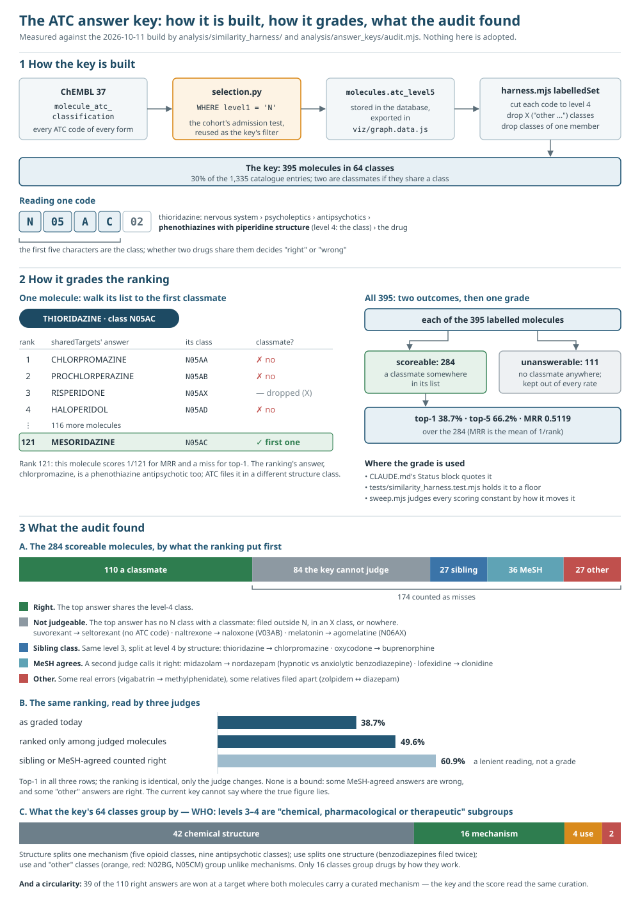
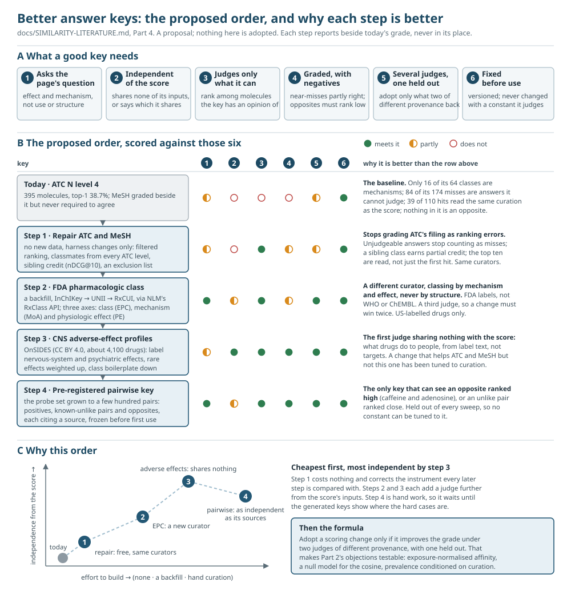

# The similarity score against the literature, and what should judge it

Written 2026-10-13 against commit `86f0614` and the active build of 2026-10-11.
**A review and a proposal; nothing in it is adopted.** Part 3's measurements
are reproduced by `node analysis/answer_keys/audit.mjs`, which is read-only.

This document asks two questions. The first is what published research says
about each choice in the shared-target score, and especially what argues
against it. The second is whether the answer key that grades the score can
tell a good ranking from a bad one. The second question comes first in
practice: every argument about the formula ends with "and the harness agreed",
so a judge that cannot tell right from wrong makes all of those arguments
unsound.

In short:

- **Only one choice in the score has a published source.** The efficacy
  papers behind D19 (Part 2.7). Each of the others was argued from the data
  and graded against ATC. Three findings in the literature push against the
  design: a molecule's target count mostly measures how much it was studied;
  potency only means something relative to exposure; and a fixed list of
  opposite actions rests on labels that change with the assay.
- **The answer key marks right answers wrong.** The ranking misses top-1 for
  174 of 284 molecules. **In 84 of the 174, the top answer is a molecule the
  key has no class for**: suvorexant's nearest neighbour is seltorexant, and
  naltrexone's is naloxone. In 27 more, the top answer is in a sibling class
  that ATC splits by chemical structure, as with thioridazine and
  chlorpromazine. If the key ranked each molecule only among the molecules it
  can judge, top-1 would be 49.6% rather than 38.7%, with no change to the
  ranking.
- **42 of the key's 64 classes are chemical-structure groups, and 4 more group
  drugs by use.** Only 16 are mechanism groups. WHO itself defines ATC levels
  3 and 4 as "chemical, pharmacological or therapeutic" subgroups. That
  contradicts the harness's description of level 4 as "the WHO's own grouping
  of drugs by how they work".
- **Proposed order:** repair the two keys already in use (no new data); add the
  FDA's Established Pharmacologic Class; add a key independent of target data
  (CNS adverse-effect profiles from OnSIDES); and pre-register a pairwise key
  that includes negatives and opposites (Part 4).

Every citation links to the paper through its DOI. Each DOI was resolved
against Crossref on 2026-10-13.

---

## 1. The score, in one line

For a selected molecule *a* and every other molecule *b*, `sharedTargets` in
`viz/index.html` computes:

```
score(a, b) = Σ over shared proteins t of
                 kind(t) × min(evidence_a(t), evidence_b(t)) × prevalence(t) × √(species(t))
              × direction factor
              ÷ √(targets(a) × targets(b))
```

| term | what it is | where |
| --- | --- | --- |
| `kind` | 1.0 for a single protein or complex, 0.5 for a family or complex group, 0 where a family repeats proteins already shared | `TARGET_WEIGHT`, subsumption |
| `evidence` | 1.0 curated and replicated, 0.9 replicated in ≥2 publications within one endpoint class, 0.75 curated only, 0.5 Preliminary; the weaker side counts | `evidenceWeight` |
| `prevalence` | `log(1 + N/df) / log(1 + N)`, an inverse-document-frequency (IDF) discount | `prevalenceWeight` |
| `√species` | one protein in *n* species' records is worth *n*^0.5 of one record (D20) | `SPECIES_EXPONENT` |
| direction | `1 − 0.75 × (opposed + ½·half-opposed) / comparable`; a pair opposed at every protein where both have a curated direction scores a quarter (D15, D19) | `OPPOSED_PAIR_FACTOR`, `opposedShare` |
| ÷ √(deg·deg) | cosine (Ochiai) normalisation by each molecule's target count, counted in proteins | end of `sharedTargets` |

Affinity is not in it, and nor is exposure or brain penetration.

---

## 2. What the literature says about each term

The verdicts in this part are against **this project's** choice, not about
whether a paper is right. *For* means the paper supports the choice,
*against* means it argues the choice is wrong, and *complicates* means it
changes what the choice can claim. A summary marked *(snippet)* was written
from an abstract or search result, because the full text was behind a
captcha.

### 2.1 The prevalence discount

| paper | finding | verdict |
| --- | --- | --- |
| Campillos et al. 2008, [*Drug target identification using side-effect similarity*](https://doi.org/10.1126/science.1158140), Science | Weights each side effect by its rarity before comparing two drugs' profiles. The same IDF idea, applied to phenotypes. | for |
| Bowes et al. 2012, [*Reducing safety-related drug attrition: the use of in vitro pharmacological profiling*](https://doi.org/10.1038/nrd3845), Nat Rev Drug Discov | Four companies' standard safety panels (hERG, adrenoceptors, muscarinics) are run on nearly everything. A hit on one of these targets reflects what gets screened, not a mechanism. | for |
| Haynes, Tomczak & Khatri 2018, [*Gene annotation bias impedes biomedical research*](https://doi.org/10.1038/s41598-018-19333-x), Sci Rep | Annotation concentrates on genes already studied, whatever their biological importance. | against: `df` measures attention as well as specificity |
| Mestres et al. 2008, [*Data completeness — the Achilles heel of drug-target networks*](https://doi.org/10.1038/nbt0908-983), Nat Biotechnol | Which drugs and targets look most connected changes with which databases are merged. | against: same point |

**Against this project specifically.** SIMILARITY-DIAGNOSIS §4.2 found that
SERT is measured as often as hERG and so is discounted as hard. These two
papers explain why: `df` cannot tell a mechanism target from a screening
target. Bowes 2012 names the screening targets, which supports conditioning
the discount on the curated-mechanism ratio, still listed in CLAUDE.md as not
done. **No paper tests an IDF-weighted target overlap against an unweighted
one.** The harness's measurement may be the only evidence there is.

### 2.2 Normalising by each molecule's target count

| paper | finding | verdict |
| --- | --- | --- |
| Mestres et al. 2009, [*The topology of drug–target interaction networks*](https://doi.org/10.1039/b905821b), Mol BioSyst | A molecule's number of targets depends on how complete the data is and which target families were tested, as well as on its pharmacology. | against |
| Udrescu, Ardelean & Udrescu 2023, [*The curse and blessing of abundance*](https://doi.org/10.1093/gigascience/giad011), GigaScience | Drug–target databases hold positive evidence only: "absence of evidence is not evidence of absence". | against every set-overlap measure: a zero mostly means "not tested" |
| Guney, Menche, Vidal & Barabási 2016, [*Network-based in silico drug efficacy screening*](https://doi.org/10.1038/ncomms10331), Nat Commun | Corrects for degree by comparing each overlap with random sets of matched degree (a z-score), not by dividing. | complicates: the standard remedy is a null model |
| Keiser et al. 2007, [*Relating protein pharmacology by ligand chemistry*](https://doi.org/10.1038/nbt1284), Nat Biotechnol | SEA scores each overlap against the size-matched overlap expected by chance (an E-value), never a raw count. | complicates: same point |
| Yıldırım et al. 2007, [*Drug–target network*](https://doi.org/10.1038/nbt1338), Nat Biotechnol | The founding drug–target network paper; targets' degrees run above the interactome average because of literature bias. | complicates |
| Cheng, Kovács & Barabási 2019, [*Network-based prediction of drug combinations*](https://doi.org/10.1038/s41467-019-09186-x), Nat Commun | Of six ways two drugs' targets can relate in the interactome, heavy overlap marked redundancy, not efficacy. | complicates; about combinations, not classes |
| Cheng et al. 2018, [*Network-based approach to prediction and population-based validation of in silico drug repurposing*](https://doi.org/10.1038/s41467-018-05116-5), Nat Commun | Network proximity predictions held up in patient data for 2 of 4 tested. | complicates: shows a validation set that is not a classification |

Dividing by √(deg·deg) shrinks the study-effort bias but does not remove it.
The aripiprazole result in SIMILARITY-HARNESS.md is one symptom of that bias,
and the normalisation hides it rather than curing it. The alternative the
literature uses is a null model: compare each pair's overlap with the
overlaps of random pairs whose target counts match.

### 2.3 Exact protein matching, and families at half weight

| paper | finding | verdict |
| --- | --- | --- |
| Yamanishi et al. 2008, [*Prediction of drug–target interaction networks from the integration of chemical and genomic spaces*](https://doi.org/10.1093/bioinformatics/btn162), Bioinformatics | Predicts interactions from drug similarity and target sequence similarity jointly. | against: ADORA1 vs ADORA2A scoring 0 discards a signal these methods use |
| Perlman et al. 2011, [*Combining drug and gene similarity measures for drug-target elucidation*](https://doi.org/10.1089/cmb.2010.0213), J Comput Biol | Gene–gene similarity is a first-class input and improved prediction. | against: same point |
| Paolini et al. 2006, [*Global mapping of pharmacological space*](https://doi.org/10.1038/nbt1228), Nat Biotechnol | Maps 727 human targets by the ligands they share below 10 µM. | complicates: relatedness between targets is measurable from ligands |

**No paper tests a 0.5 weight for a family.** The constant is unsupported
either way.

### 2.4 Evidence tiers

| paper | finding | verdict |
| --- | --- | --- |
| Kramer et al. 2012, [*The experimental uncertainty of heterogeneous public Ki data*](https://doi.org/10.1021/jm300131x), J Med Chem | Over 90% of ChEMBL's apparently repeated Ki measurements are the same value republished. | for D08's count of distinct studies, which answers exactly this |
| Landrum & Riniker 2024, [*Combining IC50 or Ki values from different sources is a source of significant noise*](https://doi.org/10.1021/acs.jcim.4c00049), J Chem Inf Model | 27% of IC50 pairs from different sources differ by more than 10×; matching assay metadata helps only partly. | for keeping endpoints apart; complicates how much "replicated" guarantees |
| Kalliokoski et al. 2013, [*Comparability of mixed IC50 data — a statistical analysis*](https://doi.org/10.1371/journal.pone.0061007), PLoS ONE | Mixed IC50 data are only about 25% noisier than Ki data. | partly for |
| Tiikkainen et al. 2013, [*Estimating error rates in bioactivity databases*](https://doi.org/10.1021/ci400099q), J Chem Inf Model | Across ChEMBL, Liceptor and WOMBAT the commonest errors are, in order, in the structure, the target assignment, the value and the activity type. | complicates: a wrong target is the second commonest error |
| Papadatos et al. 2015, [*Activity, assay and target data curation and quality in the ChEMBL database*](https://doi.org/10.1007/s10822-015-9860-5), J Comput Aided Mol Des | Describes ChEMBL's curation of activity data and its flag-rather-than-delete policy. | complicates: none of it measures the mechanism table's `action_type` |
| Tang et al. 2014, [*Making sense of large-scale kinase inhibitor bioactivity data sets*](https://doi.org/10.1021/ci400709d), J Chem Inf Model | Ki, Kd and IC50 data disagree across databases, and ignoring that biases polypharmacology models. | complicates |
| Southan, Sitzmann & Muresan 2013, [*Comparing the chemical structure and protein content of ChEMBL, DrugBank, HMDB and TTD*](https://doi.org/10.1002/minf.201300103), Mol Inform | "Target" means different things in each database: drug targets in DrugBank and TTD, any assayed protein, across species, in ChEMBL. | complicates the curated tier |

Mestres 2008 applies here too: replication tracks how heavily a target is
studied. That makes the 0.9-over-0.75 ordering, the setting the ranking
responds to most, partly a measure of research effort.

### 2.5 Affinity and exposure, which the score leaves out

This strand argues against the current design more strongly than any other.

| paper | finding | verdict |
| --- | --- | --- |
| Sutherland et al. 2023, [*A preclinical secondary pharmacology resource illuminates target-adverse drug reaction associations of marketed drugs*](https://doi.org/10.1038/s41467-023-40064-9), Nat Commun | For 1,958 drugs with free Cmax (peak unbound plasma concentration), potency relative to Cmax linked targets to adverse reactions better than any fixed potency cutoff *(snippet)*. | against |
| Davis et al. 2011, [*Comprehensive analysis of kinase inhibitor selectivity*](https://doi.org/10.1038/nbt.1990), Nat Biotechnol | 72 inhibitors against 442 kinases: within a list of "hits", Kd spans orders of magnitude. | against counting presence only |
| Karaman et al. 2008, [*A quantitative analysis of kinase inhibitor selectivity*](https://doi.org/10.1038/nbt1358), Nat Biotechnol | Introduced a selectivity score computed from affinities, not from a hit list. | against, same point |
| Lounkine et al. 2012, [*Large-scale prediction and testing of drug activity on side-effect targets*](https://doi.org/10.1038/nature11159), Nature | About half of the predicted off-target activities were confirmed, and weak ones can explain side effects. | mixed: weak is not unreal (invariant 8), but relevance still needs potency |
| Loryan et al. 2022, [*Unbound brain-to-plasma partition coefficient, Kp,uu,brain*](https://doi.org/10.1007/s11095-022-03246-6), Pharm Res | What drives a CNS response is the unbound brain concentration, not binding alone. | against treating target overlap as brain overlap |
| Yanai & Tashiro 2007, [*The physiological and pathophysiological roles of neuronal histamine: an insight from human PET studies*](https://doi.org/10.1016/j.pharmthera.2006.06.008), Pharmacol Ther | First-generation antihistamines occupy most brain H1 receptors and sedate; second-generation ones occupy few. | against: the same H1 overlap gives opposite effects in the brain |
| Roth, Sheffler & Kroeze 2004, [*Magic shotguns versus magic bullets*](https://doi.org/10.1038/nrd1346), Nat Rev Drug Discov | Many CNS drugs work through multi-target profiles. | for the premise; but only the targets occupied at clinical doses count |
| Besnard et al. 2012, [*Automated design of ligands to polypharmacological profiles*](https://doi.org/10.1038/nature11691), Nature | Target profiles designed for the brain were confirmed 75% of the time, with brain penetration designed in *(snippet)*. | for profiles; points at what the score omits |

**What this means for this project.** CLAUDE.md records that weighting by
affinity was prototyped and graded worse. In this literature potency is
normalised to exposure (Cmax/Ki), not used as raw nanomolar. The raw form was
the prototype, so its failure does not rule out the form these papers use.
This is an inference, not a measurement.

### 2.6 One protein across species (D20)

| paper | finding | verdict |
| --- | --- | --- |
| Oksenberg et al. 1992, [*A single amino-acid difference confers major pharmacological variation between human and rodent 5-HT1B receptors*](https://doi.org/10.1038/360161a0), Nature | Thr355 against Asn355 changes the receptor's pharmacology, and swapping the residue converts it. | against for this target |
| Barr & Watson 1993, [*Non-peptide antagonists, CP-96,345 and RP 67580, distinguish species variants in tachykinin NK1 receptors*](https://doi.org/10.1111/j.1476-5381.1993.tb13466.x), Br J Pharmacol | CP-96,345 is about 200× weaker at rat NK1 than at human, and RP 67580 is the reverse *(snippet)*. | against: pooling species can reverse a selectivity |
| Donnelly-Roberts et al. 2009, [*Mammalian P2X7 receptor pharmacology*](https://doi.org/10.1111/j.1476-5381.2009.00233.x), Br J Pharmacol | The antagonists that define P2X7 block all three species, but many other compounds do not. | partly for |

**A concrete risk.** D20 matches orthologues by sequence and the score ignores
affinity. So a claim on the rat 5-HT1B record can stand for the human protein
in a pair's score, for a ligand the human receptor binds far more weakly. The
rule partly guards against this: the strongest record counts, and each
record keeps its own claims. But √n rewards the breadth of assays across
species, not relevance to humans.

### 2.7 Direction and opposition (D15, D19)

| paper | finding | verdict |
| --- | --- | --- |
| Neubig et al. 2003, [*IUPHAR … XXXVIII. Update on terms and symbols in quantitative pharmacology*](https://doi.org/10.1124/pr.55.4.4), Pharmacol Rev | Defines agonist, partial agonist, antagonist and inverse agonist on one efficacy scale. | for D19 (already cited there) |
| Kenakin 2004, [*Efficacy as a vector: the relative prevalence and paucity of inverse agonism*](https://doi.org/10.1124/mol.65.1.2), Mol Pharmacol | Of 380 GPCR "antagonists" tested, 322 (85%) were inverse agonists. | for not opposing antagonist and inverse agonist |
| Hall & Strange 1997, [*Evidence that antipsychotic drugs are inverse agonists at D2 dopamine receptors*](https://doi.org/10.1038/sj.bjp.0701196), Br J Pharmacol | Clinical D2 "antagonists" behave as inverse agonists. | for, same point |
| Ballber Torres & Altafini 2016, [*Drug combinatorics and side effect estimation on the signed human drug-target network*](https://doi.org/10.1186/s12918-016-0326-8), BMC Syst Biol | Signs every drug–target edge. Most pairs agree in sign at shared targets; pairs with opposite signs are a minority whose effects offset. | for signing; untested as a ranking signal |
| Rothman & Baumann 2006, [*Therapeutic potential of monoamine transporter substrates*](https://doi.org/10.2174/156802606778249766), Curr Top Med Chem | Transporter blockers and releasers both raise extracellular monoamine, by different mechanisms. | for not opposing inhibitor and releaser |
| Urban et al. 2007, [*Functional selectivity and classical concepts of quantitative pharmacology*](https://doi.org/10.1124/jpet.106.104463), J Pharmacol Exp Ther | One ligand can be an agonist on one pathway and an antagonist on another. | against a fixed list of opposites |
| Urban, Vargas, von Zastrow & Mailman 2007, [*Aripiprazole has functionally selective actions at dopamine D2 receptor-mediated signaling pathways*](https://doi.org/10.1038/sj.npp.1301071), Neuropsychopharmacology | Aripiprazole is an agonist, partial agonist or antagonist depending on the pathway and cell system. | against a fixed ½ for partial agonists |
| Mailman & Murthy 2009, [*Ligand functional selectivity advances our understanding of drug mechanisms and drug discovery*](https://doi.org/10.1038/npp.2009.117), Neuropsychopharmacology | Drugs with the same target and the same action label can differ clinically. | complicates |
| Perszyk et al. 2018, [*An NMDAR positive and negative allosteric modulator series share a binding site and are interconverted by methyl groups*](https://doi.org/10.7554/eLife.34711), eLife | A methyl group turns a positive allosteric modulator (PAM) into a negative one (NAM) at the same site. | complicates: the sign is opposite, the pharmacology close |
| Paolini 2006 (§2.3); Keiser 2007 (§2.2); Keiser et al. 2009, [*Predicting new molecular targets for known drugs*](https://doi.org/10.1038/nature08506), Nature | The field's standard pharmacological neighbourhoods ignore direction. | complicates |
| Lamb et al. 2006, [*The Connectivity Map*](https://doi.org/10.1126/science.1132939), Science; Sirota et al. 2011, [*Discovery and preclinical validation of drug indications using compendia of public gene expression data*](https://doi.org/10.1126/scitranslmed.3001318), Sci Transl Med; Iorio et al. 2010, [*Discovery of drug mode of action and drug repositioning from transcriptional responses*](https://doi.org/10.1073/pnas.1000138107), PNAS | Opposite expression signatures are informative relations, not noise. | for 0.25 rather than 0 |

**Gaps.** No published study measures whether a direction penalty improves a
similarity ranking; the harness's D15 result (worst setting under both judges
when switched off) may be the only measurement. No study gives an error rate
for `action_type` in ChEMBL, GtoPdb or DrugBank either; the closest is
Tiikkainen 2013, whose "activity type" means Ki or IC50. DTIAM ([Lu et al.
2023, arXiv](https://arxiv.org/abs/2312.15252)) notes that few methods model
activation against inhibition at all.

---

## 3. How the answer key is built today



*The whole of this part in one picture. Each panel is spelled out below: §3.1 for 1, §3.1–3.3 for 2, §3.4–3.5 for 3.*

### 3.1 The ATC key, step by step

1. **ChEMBL's `molecule_atc_classification`** is read by
   `scripts/cohort/selection.py`, in a query that ends
   `WHERE a.level1 = 'N'`. That clause is the **route_atc_n admission test**.
   It decides who enters the cohort, and it was never written to define a key.
2. The N codes are stored as `molecules.atc_level5`, `|`-joined across forms,
   and `scripts/cohort/export.py` ships them in `viz/graph.data.js`. The page
   does not display them (taken off 2026-09-26).
3. **`labelledSet`** in `analysis/similarity_harness/harness.mjs` splits each
   molecule's codes, truncates each to five characters (level 4: `N06AB`),
   drops any whose fifth character is `X` ("other …"), and drops classes with
   one member. **395 molecules in 64 classes.**
4. **`grade`** calls the page's own `sharedTargets(id)` for each labelled
   molecule and walks down the list to the first molecule sharing a level-4
   code. That position is its rank. A molecule with no classmate anywhere in
   its list is *unanswerable* and kept out of every rate: **111**, leaving
   **284 scoreable**.
5. Over the 284: **top-1 38.7%, top-5 66.2%, top-10 77.1%, MRR 0.5119**
   (MRR is the mean of 1/rank). These figures go into CLAUDE.md's Status block;
   `tests/similarity_harness.test.mjs` holds them to a floor; and `sweep.mjs`
   reports each constant as a change in them.

### 3.2 The MeSH key

`meshActionSet` reads the `mesh_pa` classes that
`scripts/resolve_cohort_pharm_actions.py` backfills. These are NLM's
pharmacological actions, reached by InChIKey through PubChem. It keeps
actions a molecule is indexed with *directly* at MeSH tree depth 5 or deeper,
and drops classes of one: **699 molecules in 175 classes, 588 scoreable,
top-1 47.4%, MRR 0.6060** (`evaluate.mjs --key mesh`). The grading is the same
walk to the first classmate.

### 3.3 The probe set

`analysis/probe/probes.mjs` holds 50 hand-written relationships, of three
kinds: mechanism, `opposite` and non-N. They are a diagnostic, never summed
into a number a constant is swept against (SIMILARITY-DIAGNOSIS §2). They
are the only place a known-dissimilar pair (caffeine and adenosine) is
tested at all.

### 3.4 What the ATC key gets wrong, measured

`node analysis/answer_keys/audit.mjs --misses --classes` puts every top-1 miss
into the first of four buckets that holds:

| the top answer … | misses | share | examples |
| --- | --- | --- | --- |
| has **no N code with a classmate** (it is filed outside N, in an `X` class, or nowhere), so the key has no opinion of it | **84** | 48.3% | suvorexant, lemborexant, daridorexant → seltorexant (no ATC code); naltrexone, ondelopran → naloxone (V03AB); melatonin → agomelatine (N06AX); scopolamine → atropine (A03BA); apomorphine → dopamine (C01CA) |
| is in a **sibling class** (same level 3) | **27** | 15.5% | thioridazine → chlorpromazine (piperidine against aliphatic phenothiazines); oxycodone → buprenorphine; fluphenazine → chlorpromazine; haloperidol → clozapine |
| shares a **MeSH action** with the query | **36** | 20.7% | flunitrazepam → diazepam and midazolam → nordazepam (benzodiazepines filed as hypnotics against anxiolytics); lofexidine → clonidine; codeine → hydrocodone; caffeine → theophylline (the anhydrous record carries no N code) |
| none of these | **27** | 15.5% | vigabatrin → methylphenidate (an error); but also zolpidem ↔ diazepam, ipidacrine → neostigmine and carbamazepine → lidocaine (GABA-A modulators, anticholinesterases and sodium-channel blockers the key files apart) |

Two other readings of the same ranking follow from the table. Neither
changes the ranking; each changes only the judge:

- **Ranked only among molecules the key can judge**, the "filtered" setting
  that link-prediction work uses for the same problem ([Bordes et al. 2013,
  NeurIPS](https://papers.nips.cc/paper/2013/hash/1cecc7a77928ca8133fa24680a88d2f9-Abstract.html)):
  **top-1 49.6%, MRR 0.6168**, up from 38.7% and 0.5119.
- **Counting a sibling-class or MeSH-agreed answer as right**: top-1
  **60.9%**. That is a lenient reading, not a grade.

**Neither figure is a bound.** Some answers counted right in the lenient
reading are wrong in a way ATC gets right: rasagiline → moclobemide is an MAO-B
inhibitor against an MAO-A one, and MeSH files both under one action. And some
answers in the last row of the table are right: zolpidem and diazepam act at the
same GABA-A site. The current key cannot say where the true top-1 lies. A
better key can (Part 4).

**One more measurement points at circularity.** Of the 110 top-1 hits, 39
(35.5%) are won chiefly by a target at which **both** molecules have a
curated mechanism. There the key and the score are reading the same curation:
a WHO classification that follows mechanism, and a ChEMBL mechanism table
that encodes the same mechanism.

### 3.5 What the 64 classes group by

WHO defines ATC levels 3 and 4 as "Chemical, Pharmacological or Therapeutic
subgroup" ([WHO, *ATC classification*](https://www.who.int/tools/atc-ddd-toolkit/atc-classification)).
Read by name, the key's 64 classes split as follows:

| grouped by | classes | which |
| --- | --- | --- |
| **chemical structure** | **42** | the five opioid structure groups N02AA–N02AF; nine antipsychotic structure groups N05AA–N05AL; hydantoins, succinimides, barbiturates (three times: N01AF, N03AA, N05CA), benzodiazepines (twice: N05BA, N05CD), local-anaesthetic esters and amides, salicylates, ergot alkaloids, xanthines, … |
| **mechanism** | **16** | SSRIs, non-selective reuptake inhibitors, MAO inhibitors (three classes), dopamine agonists, triptans, CGRP antagonists, gabapentinoids, melatonin agonists, orexin antagonists, anticholinesterases (twice: N06DA, N07AA), centrally acting sympathomimetics, benzodiazepine-related drugs, opioid anaesthetics |
| **use** | **4** | drugs used in nicotine, alcohol or opioid dependence; antivertigo preparations |
| **"other" without an X** | **2** | N02BG *other analgesics and antipyretics*; N05CM *other hypnotics and sedatives* — the junk drawer the `X` rule exists to drop, filed under another letter |

The classification is mine, by class name, and a few classes could be filed
either way. But the shape is not in doubt, and it explains the misses in
§3.4. Structure classes **split one mechanism** across several classes:
every opioid agonist sits in one of five classes, every D2 antagonist in one
of nine. Use **splits one structure**: the same benzodiazepines are filed as
anxiolytics and as hypnotics, and the same anticholinesterases as dementia
drugs and as parasympathomimetics. Use classes and residual classes **merge
unlike mechanisms**: disulfiram, naltrexone and acamprosate share
*drugs used in alcohol dependence* with naltrexone, nalmefene and carbimide (disulfiram's rank is 401). The harness and CLAUDE.md
describe level 4 as "where the WHO groups drugs by how they work". **WHO says
otherwise**, and that sentence should be corrected where it appears,
including the text `scripts/cohort/status.py` writes into Status.

### 3.6 The key's defects, listed

1. **It inherits an admission filter.** Only N codes, so a right answer filed
   elsewhere (naloxone, V03AB) or nowhere (seltorexant) counts as a miss. This
   is half of all misses.
2. **It mostly groups by structure, and partly by use.** See §3.5.
3. **It is binary.** A sibling-class answer scores the same as an unrelated
   one.
4. **It has no negatives.** Nothing in it says "these two must *not* be near",
   so it cannot see an opposite ranked high. D15 exists because of exactly
   that error.
5. **It reads only the first hit.** What sits above the first classmate is
   never inspected.
6. **It shares a source with the score.** Over a third of the hits rest on
   curated mechanisms on both sides (§3.4).
7. **It covers 30% of the catalogue** (395 of 1,335); MeSH covers 52%.

---

## 4. Better answer keys



*The whole of this part in one picture: §4.1 is panel A, §4.2–4.3 are panels B and C. The marks in panel B are a judgement against §4.1's six properties, not a measurement.*

### 4.1 What a key should satisfy

1. **It asks the page's question.** "May act in similar ways in the brain"
   means effect and mechanism, not therapeutic use and not chemical structure.
2. **Its provenance is stated.** For each key, say which of the score's inputs
   it shares: ChEMBL bioactivity, ChEMBL mechanisms, GtoPdb. A key that shares
   none is worth more than one that shares several, and the grade should say
   which kind it is.
3. **It judges only what it can judge.** Rank among judged molecules only
   (§3.4), and keep coverage a separate number, as the harness already does
   for unanswerable molecules.
4. **It is graded and has negatives.** Relevance in levels (same mechanism,
   same broader class, unrelated, opposite), scored with nDCG (normalised
   discounted cumulative gain) over the top of the list
   ([Järvelin & Kekäläinen 2002](https://doi.org/10.1145/582415.582418)), plus
   a pairwise check that known-unlike and opposite pairs rank low.
5. **There are several judges, and one is held out.** Adopt a constant only
   when it improves the grade under at least two judges of different
   provenance, and keep one key out of every sweep, so that the sweep cannot
   tune to it.
6. **It is fixed before use.** Each key is versioned, and a change to a key is
   logged like a policy change. A key is never revised in the same change as
   a constant it judges.

### 4.2 The candidates

| key | measures | shares with the score | coverage | access, licence | verdict |
| --- | --- | --- | --- | --- | --- |
| **ATC, repaired** | WHO class, with the §3.6 defects fixed | partly the mechanisms | 395 now; 759 if every ATC level is read (SIMILARITY-DIAGNOSIS §1) | in the database | **first; no new data** |
| **MeSH actions, filtered** | NLM's indexed actions | mostly the literature, not ChEMBL; many actions name a mechanism | 699 | in the database | **keep; filter it** |
| **FDA Established Pharmacologic Class (EPC), mechanism of action (MoA) and physiologic effect (PE)** | FDA's label-derived class, mechanism and effect | separate curator; EPC and MoA restate mechanism, PE is an effect axis | US-labelled drugs only | NLM RxClass REST API, no key: `class/byDrugName.json?drugName=sertraline&relaSource=DAILYMED` returned EPC *Serotonin Reuptake Inhibitor* on 2026-10-13. Joins on UNII, which the MeSH structure backfill already uses | **third judge** |
| **CNS adverse-effect profiles** | similarity of nervous-system and psychiatric adverse effects on the label | **nothing**: label text, not targets | about 4,100 ingredients | OnSIDES, CC BY 4.0, RxNorm-keyed ([Tanaka et al. 2025](https://doi.org/10.1016/j.medj.2025.100642), [GitHub](https://github.com/tatonetti-lab/onsides)); SIDER 4.1 is older ([Kuhn et al. 2016](https://doi.org/10.1093/nar/gkv1075)) | **the first independent judge** |
| **Pre-registered pairwise key** | settled relationships, positive, negative and opposite, each sourced | depends on the sources cited | a few hundred pairs | written here | **diagnostic and held-out test** |
| Drug discrimination | whether animals trained on drug A take drug B for it: the classic measure of "feels alike" | nothing | dozens of training drugs | the Stolerman/Meisch bibliography indexes papers, not results; extracting them is manual | research-grade; pilot by hand |
| Zebrafish behavioural profiles | behavioural fingerprints of neuroactive compounds | nothing | hundreds of known drugs | supplementary tables of [Rihel et al. 2010](https://doi.org/10.1126/science.1183090), [Kokel et al. 2010](https://doi.org/10.1038/nchembio.307) and [Bruni et al. 2016](https://doi.org/10.1038/nchembio.2097); joined by name only | research-grade |
| Dose-equivalence tables | "interchangeable at some dose" | nothing | a few dozen drugs, within one class each | [Leucht et al. 2016](https://doi.org/10.1093/schbul/sbv167), [Leucht et al. 2015](https://doi.org/10.1093/schbul/sbv037), [Hayasaka et al. 2015](https://doi.org/10.1016/j.jad.2015.03.021) | sanity check only: it cannot test across classes |
| L1000 transcription | gene-expression response | nothing | about 20,000 compounds | [Subramanian et al. 2017](https://doi.org/10.1016/j.cell.2017.10.049); GEO | **no**: cancer cell lines lack the receptors most CNS drugs act on |
| Drug Repurposing Hub MOA | curated mechanism strings | the same kind of knowledge as ChEMBL's mechanisms | about 6,000 compounds | [Corsello et al. 2017](https://doi.org/10.1038/nm.4306); non-commercial terms | **no**: circular, and the licence does not fit |
| KEGG drug groups, DrugBank categories | classes | ATC-derived or target-derived | — | restricted licences | **no** |

**Two cautions about the adverse-effect key.** First, labels carry class
boilerplate: every antidepressant label has the suicidality warning and every
benzodiazepine label the boxed warning on opioids. A label-derived profile is
therefore partly a class key in disguise, and class-wide terms want the same
IDF treatment §2.1 gives targets. Second, adverse effects are confounded by
indication. Drugs for one disease list that disease's symptoms. Campillos
2008 showed that side-effect similarity does track shared targets, so the
signal is there, but it needs restricting to the nervous-system and
psychiatric organ classes and weighting by rarity before it is a key.
[Vilar & Hripcsak 2016](https://doi.org/10.1093/bib/bbw048) review profile
similarities of this kind.

The critiques of ATC are not only this project's. [Winnenburg & Bodenreider
2013](https://pubmed.ncbi.nlm.nih.gov/23920673/) quote the WHO's own caveat
that drugs in one level-4 group "cannot be considered pharmacotherapeutically
equivalent". [Bindel 2025, *Problems associated with the ATC system of drug
classification*](https://doi.org/10.1007/s00210-025-04833-1) argues that it
mixes anatomical, therapeutic, pharmacological and chemical principles within
and across levels *(snippet)*. Using ATC as a benchmark is common practice anyway:
[SuperPred, Dunkel et al. 2008](https://doi.org/10.1093/nar/gkn307);
[Hert et al. 2008](https://doi.org/10.1021/ci8000259); and
[GraphATC, Zhang et al. 2025](https://doi.org/10.1093/bib/bbaf194).

### 4.3 Proposed order

Each step is its own change, and each reports beside the existing grade,
never in place of it.

**Step 1 — repair what is there (no new data).** In `harness.mjs`:

- add the filtered ranking (§3.4) to both keys;
- read every ATC level of the catalogue's molecules for *peers*, while keeping
  the N set as the questions. The codes are already in `molecule_classes`
  (source `atc`), but the payload stopped carrying them when ATC came off the
  page, so either the export carries them again or the harness reads the
  database;
- add graded credit for a sibling class at level 3, reported as nDCG@10 beside
  MRR;
- extend the `X` rule into a documented exclusion list (N02BG, N05CM and the
  four use classes, with a reason for each), following SIMILARITY-DIAGNOSIS
  §1's call for one;
- correct the "how they work" sentence.

This answers how good the ranking is, and lets the harness stop reporting
ATC's filing conventions as ranking errors.

**Step 2 — FDA Established Pharmacologic Class.** A backfill in the house
style:

- identifier-only (InChIKey → UNII → RxCUI);
- idempotent, with `--dry-run`;
- writing a new `molecule_classes` source;
- graded by `evaluate.mjs --key epc`.

Pull the physiologic-effect (PE) axis too, which is the closest thing in the
candidates to an effect key. Drop metabolic and enzyme MoA classes that say
nothing about the brain: sertraline's MoA includes *Cytochrome P450 2D6
Inhibitors*.

**Step 3 — the first independent judge.** CNS adverse-effect profiles from
OnSIDES:

- MedDRA terms restricted to nervous-system and psychiatric disorders;
- IDF-weighted, as §4.2 asks;
- each molecule's nearest label neighbours are its graded relevant set.

This is the first key that shares no input with the score. A constant that
helps under ATC and MeSH but not here has been tuned to curation.

**Step 4 — a pre-registered pairwise key.** Grow the probe set into a
versioned file of a few hundred pairs:

- positives, known-unlike negatives (same indication, different mechanism)
  and opposites;
- each pair citing its source;
- written and frozen before the run it first judges.

SIMILARITY-HARNESS §3 refuses a hand-written key because it can be bent to
say anything. Pre-registration and a source per pair are the answer to that
objection. The key stays held out from sweeps.

**Then the formula.** With two judges that do not share the score's inputs,
the open questions in Part 2 become measurable rather than arguable:

- exposure-normalised affinity (§2.5);
- a null-model normalisation in place of the cosine (§2.2);
- conditioning prevalence on curation (§2.1);
- similarity between targets for subtypes (§2.3).

The same applies to each constant SIMILARITY-HARNESS.md lists as unvalidated.

---

## 5. How much to trust this document

- **Every DOI above was resolved on Crossref**, and the WHO and NeurIPS pages
  were fetched, on 2026-10-13. The PubMed record for Winnenburg & Bodenreider
  was read through NCBI's API. DTIAM is an arXiv preprint with no Crossref
  record.
- Summaries marked *(snippet)* rest on an abstract or a search result, because
  the full text was behind a captcha. A few others in Part 2 were written from
  the abstract as well.
- The literature search was run by three subagents in parallel, and the
  survey of candidate keys by a fourth. I checked their identifiers. Their
  readings of each paper are summaries, not quotations.
- The numbers in Part 3 are from `analysis/answer_keys/audit.mjs` against the
  2026-10-11 build. The class-by-principle table (§3.5) is a judgement by
  class name.
- **Not measured here:** EPC and OnSIDES coverage of this catalogue, and
  whether any key in §4.2 agrees with ATC or MeSH more often than chance.
  Measuring that agreement between keys belongs in step 1. It is the ceiling
  any ranking can reach against them.
